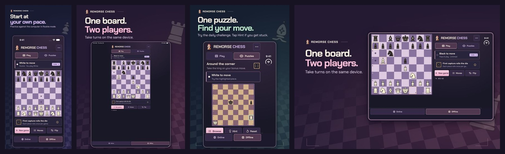

# App Store screenshots

These JPEGs use actual simulator captures. Upload them in App Store Connect under **iOS 1.0 → App Previews and Screenshots**.

| Slot | File | Pixels |
| --- | --- | --- |
| iPhone with Dynamic Island, medium | [Dice captures](01-iPhone-Capture.jpg) | 1206 × 2622 |
| iPhone with Dynamic Island, medium | [Online matchmaking](02-iPhone-Online.jpg) | 1206 × 2622 |
| iPhone with Dynamic Island, medium | [Rookie, daily puzzle, and pass and play](iphone/) | 1206 × 2622 |
| iPhone with Dynamic Island, large | [Dice, Rookie, daily puzzle, and pass and play](iphone-large/) | 1320 × 2868 |
| iPad 13-inch | [Offline play](03-iPad-Offline.jpg) | 2064 × 2752 |

For the existing English (U.S.) listing, keep the original iPhone and iPad cards. The new iPhone Rookie card is already in the medium iPhone slot. Add the puzzle and pass-and-play cards from `iphone/`. In Media Manager, add the four cards from `iphone-large/` to the large iPhone slot in filename order.

The large iPhone dice card uses a real 6.3-inch iPhone simulator capture scaled into the larger canvas. The other large cards use captures from the iPhone 18 Pro Max simulator.

[Apple’s screenshot specifications](https://developer.apple.com/help/app-store-connect/reference/app-information/screenshot-specifications)

